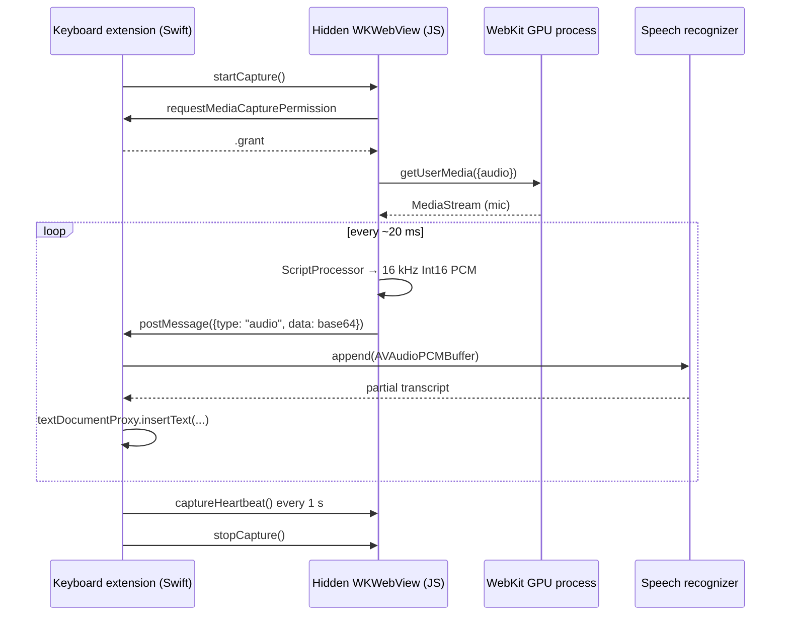

# iOS keyboard dictation without app switching

A minimal iOS custom keyboard that records your voice **from inside the keyboard**, so you can dictate into any app without bouncing to the keyboard's containing app and back.

**[Watch it on a real iPhone →](https://x.com/stephancill/status/2123484921448550893)** (dictating a reply in the X app, live transcription, no app switch)

## The problem

Most third-party dictation keyboards on iOS do an awkward dance:

1. You tap the mic on the keyboard.
2. The keyboard opens its containing app, because that's where recording works.
3. The app records, and you swipe back to where you were typing.
4. The keyboard inserts the text.

They do this because recording audio directly in a keyboard extension is unreliable. `AVAudioEngine` and `AudioQueue` in the keyboard process tend to get the extension killed or invalidated by its host app, even with Full Access.

## The trick: let WebKit hold the microphone

A keyboard extension *can* host a `WKWebView`, and WebKit doesn't capture media in the keyboard process: `getUserMedia` runs in WebKit's own WebContent and GPU processes. So the keyboard puts an invisible web view in its view hierarchy, asks it for the microphone, and streams the raw audio back to native code.



### The pieces

All of the capture code, JavaScript included, is in [`WebAudioCapture.swift`](Sources/KeyboardDictationDemoKeyboard/WebAudioCapture.swift) (about 200 lines).

**1. An invisible web view in the keyboard's hierarchy.** It stays in the window at 1×1 pt and alpha 0.01, rather than hidden or detached, because WebKit treats a web view outside a window as inactive and throttles it.

```swift
let configuration = WKWebViewConfiguration()
configuration.allowsInlineMediaPlayback = true
configuration.mediaTypesRequiringUserActionForPlayback = []
webView = WKWebView(frame: CGRect(x: 0, y: 0, width: 1, height: 1), configuration: configuration)
webView.alpha = 0.01
view.addSubview(webView)
```

**2. A secure context.** `getUserMedia` only exists on secure origins, so the inline HTML is loaded with an `https://` base URL that is never fetched:

```swift
webView.loadHTMLString(page, baseURL: URL(string: "https://keyboard-dictation.invalid/"))
```

**3. Grant the mic without a web prompt.** The app's own microphone permission still applies; this only skips WebKit's per-origin prompt.

```swift
func webView(_ webView: WKWebView, requestMediaCapturePermissionFor origin: WKSecurityOrigin,
             initiatedByFrame frame: WKFrameInfo, type: WKMediaCaptureType,
             decisionHandler: @escaping (WKPermissionDecision) -> Void) {
    decisionHandler(type == .microphone ? .grant : .deny)
}
```

**4. Raw PCM out of JavaScript.** The page sets `navigator.audioSession.type = 'play-and-record'`, opens the mic, and taps it with a `ScriptProcessorNode`. Each buffer is averaged down to 16 kHz, converted to Int16, base64-encoded and posted to native code:

```js
processor.onaudioprocess = event => {
  // ...downsample event.inputBuffer to 16 kHz Int16...
  window.webkit.messageHandlers.capture.postMessage({ type: 'audio', data: encode(output), rms });
};
```

The `AudioContext` is only created when capture starts, because creating one can grab audio focus or change the Bluetooth route while the keyboard is merely visible.

**5. A dead-man's switch.** Native code calls `captureHeartbeat()` every second. If the page misses heartbeats for 3 s (the keyboard was dismissed, or the extension was suspended or crashed), the page stops the mic itself, so it can't keep recording behind your back. It also stops on `pagehide`, on an audio-session interruption and when the track ends.

**6. Transcription.** [`DemoKeyboardViewController.swift`](Sources/KeyboardDictationDemoKeyboard/DemoKeyboardViewController.swift) wraps each chunk in an `AVAudioPCMBuffer` and feeds it to `SFSpeechAudioBufferRecognitionRequest`. Partial results are typed into the host field through `textDocumentProxy`; as a partial is refined, only the changed suffix is deleted and retyped. Any speech-to-text engine that accepts 16 kHz PCM works here, including a streaming server API over a WebSocket.

## Requirements

- **Allow Full Access.** The keyboard sets `RequestsOpenAccess = true`, and the user has to turn on Full Access in Settings.
- **Permissions granted once in the containing app.** The app requests the microphone (and Speech, for Apple's recognizer), since it can show the system prompt. The keyboard then uses them.
- **Usage descriptions in both `Info.plist`s:** `NSMicrophoneUsageDescription` and `NSSpeechRecognitionUsageDescription`.
- Public APIs only: no private frameworks or selectors.

Prior art: Raycast's iOS keyboard uses the same WebKit capture approach for its in-keyboard dictation.

## Run it

The project is a plain SwiftPM package with an app target and a keyboard extension target, built with [`stupid-app`](https://github.com/stephancill/stupid-app-cli), which builds, signs and installs iOS apps without an Xcode project:

```bash
stupid-app run --simulator
# or on a phone, after a one-time signing setup for both bundle IDs:
stupid-app signing setup --kind development --udid <device-udid>
stupid-app run --network --udid <device-udid>
```

To use Xcode instead, create an app with a Custom Keyboard Extension target, copy in `Sources/KeyboardDictationDemoKeyboard/*.swift` (with `DemoKeyboardViewController` as the extension's principal class) and `Sources/KeyboardDictationDemo/ContentView.swift`, and add the usage descriptions from the two `Info.plist`s.

Then:

1. Open **Dictation Demo** and tap **Grant permissions**.
2. Settings → General → Keyboard → Keyboards → Add New Keyboard → **Dictation Demo**, then turn on **Allow Full Access**.
3. In any app, switch to the Dictation Demo keyboard with the globe key, tap **Dictate**, speak, and tap **Stop**.

## Layout

```text
Sources/
  KeyboardDictationDemo/               containing app: permissions, setup steps, test field
  KeyboardDictationDemoKeyboard/
    WebAudioCapture.swift              hidden WKWebView + getUserMedia → PCM
    DemoKeyboardViewController.swift   UI, speech recognition, text insertion
Info.plist, KeyboardInfo.plist         app and keyboard extension plists
stupid-app.yml                         build and signing config
```

## License

MIT
