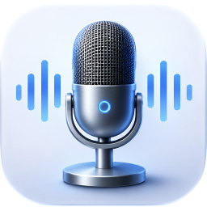

<picture>
  <source media="(prefers-color-scheme: dark)" srcset="Docs/icon-dark.png">
  
</picture>

# iDiktat

An iOS keyboard for dictating in German and English, even mixed within one sentence. It works
**completely offline**: speech recognition (NVIDIA Parakeet TDT 0.6B v3) runs on the iPhone, and
the model is part of the app. You dictate directly in any app, without switching to another app.
Above the dictation button there is a full typing keyboard for quick corrections.

The app and the keyboard are in English and German; they follow the iPhone's language.

## Thanks

Many thanks to [Stephan Cilliers](https://github.com/stephancill), whose
[ios-keyboard-dictation](https://github.com/stephancill/ios-keyboard-dictation) is the foundation
of iDiktat. It showed how a keyboard can record audio by itself through a hidden web view, so
dictation works without switching apps. The template used Apple's speech recognition, which sends
audio to Apple's servers by default; iDiktat replaces it with an on-device model.

## Building

You need **Xcode 27** or later, because the project uses the new `project.xcproj` format.

1. **Get the speech model.** It is too large for Git (~530 MB). Download `Parakeet.zip` from the
   [`model-v1` release](../../releases/tag/model-v1) and put it into `Models/` as it is, without
   unzipping. The build unpacks it into the keyboard extension in Xcode's build folder. Details in
   [`Models/README.md`](Models/README.md).
2. Open `iDiktat.xcodeproj`.
3. Set your team: copy `Config/Signing.example.xcconfig` to `Config/Signing.xcconfig` and enter
   your team ID there, e.g. `DEVELOPMENT_TEAM = AB12CD34EF`. It applies to both targets.
   `Signing.xcconfig` is ignored by Git, so your team ID never ends up in the repository. Do not
   pick the team in Xcode under *Signing & Capabilities*: Xcode would write it into
   `project.xcproj`, which is in Git.
4. If you build it under your own Apple account, replace the prefix `de.cafe-megabyte` with your
   own (see below).
5. Choose your iPhone as the destination and run (⌘R). The *iDiktat* scheme builds the optimized
   Release configuration and launches it without the debugger. To debug, switch *Product → Scheme
   → Edit Scheme… → Run* to *Debug*.

Bundle IDs: `de.cafe-megabyte.iDiktat` (app) and `de.cafe-megabyte.iDiktat.Keyboard` (keyboard),
plus the App Group `group.de.cafe-megabyte.iDiktat`, through which app and keyboard exchange data
locally in app mode. Automatic signing registers everything. If Xcode reports a signing error
about the App Group on the first build, open *Signing & Capabilities* once and Xcode creates it.

Bundle IDs and App Groups are unique across all Apple accounts. With your own account, change the
prefix in these places: `PRODUCT_BUNDLE_IDENTIFIER` (twice) in `iDiktat.xcodeproj/project.xcproj`,
the App Group in `Config/iDiktat.entitlements`, `Config/iDiktatKeyboard.entitlements` and
`Shared/AppBridge.swift` (`appGroup`). The keyboard ID must stay the app ID followed by `.Keyboard`.

**Build number:** On every build, the aggregate target *Generate Build Number* determines a
timestamp (`YYYYMMDD.HHMMSS`, e.g. `20261124.190435`). `Scripts/generate-build-number.sh` writes it
as the C constant `BUILD_NUMBER_VALUE` to `$(PROJECT_TEMP_DIR)/BuildNumber.c`. App and keyboard run
their Info.plist through the C preprocessor (`INFOPLIST_PREPROCESS = YES`,
`INFOPLIST_PREFIX_HEADER`), so both always carry the same `CFBundleVersion`. You still set the
version (`MARKETING_VERSION`, 1.0) in Xcode. That is why the Info.plists in `Config/` are written
out in full instead of being generated by Xcode.

## Setting up the iPhone

1. Open **iDiktat** and allow microphone access.
2. *Settings → General → Keyboard → Keyboards → Add New Keyboard → iDiktat*, then tap iDiktat and
   turn on **Allow Full Access**.
3. In any app, switch to iDiktat with the globe key, tap **Dictate**, speak, and tap **Stop**.

The app shows a green check mark under *2. Enable Keyboard* once everything is set up. iOS does not tell an app directly whether its keyboard has full access, so
the keyboard reports it itself through the App Group every time it opens. After turning it on, tap
**Check Now** in the app. This opens the keyboard in the test field. The first time,
switch to iDiktat there with the globe key. The test field remembers the keyboard, so afterwards
iDiktat appears there directly.

## Keyboard

Above the dictation button sits a full keyboard in the style of the iOS keyboard: QWERTZ with
umlauts and German labels if the iPhone is set to German, QWERTY otherwise. It includes numbers and symbols (123,
#+=), shift with caps lock (double tap), automatic capitalization at the start of a sentence,
". " by double space, and accents by long press (e.g. s → ß). A long press on the space bar moves
the cursor; holding delete removes characters first, then whole words. Every key gives a light
haptic tap, and opening the accents or the cursor trackpad a slightly stronger one. Third-party
keyboards cannot read the iOS setting *Keyboard Feedback → Haptic*, so it is always on. There
are no word suggestions and no autocorrection.

## Two recognition modes

Switchable in the app under *3. Recognition*:

- **In the Keyboard** (default): The keyboard records and recognizes by itself.
  You never have to switch apps, but the memory limit for keyboards applies (see below).
- **In the App** (safe mode): The keyboard loads neither the model nor the WebView and
  stays tiny. The first tap on *Dictate* jumps to the iDiktat app, which starts a session. You
  switch back and tap again. The app records in the background and sends the text back. The
  session runs until you end it in the app. While it runs, the microphone is open and iOS shows
  the orange dot. Only what you say between *Dictate* and *Stop* is processed; everything else
  is discarded immediately.

The automatic jump to the app uses a common workaround, because Apple does not officially allow
keyboards to open apps. Should it stop working in a future iOS version, the keyboard shows a hint
instead and you open the app yourself.

### Test checklist

- [ ] Keyboard mode: short dictation, long dictation (> 15 s), German and English mixed
- [ ] App mode: jump to the app, switch back, dictate, several dictations in a row
- [ ] App mode: end the session in the app → the keyboard jumps to the app again on the next dictation
- [ ] App mode: music keeps playing, phone call during the session, connecting AirPods
- [ ] Typing: fast typing with two thumbs, shift and caps lock, holding delete, accents, cursor via space bar

## Offline guarantee

- **No networking code.** Neither the app nor the keyboard uses `URLSession`, sockets, the
  `Network` framework or any other networking API. Both binaries have been checked: they link
  neither `Network` nor `CFNetwork`.
- **Apple's speech recognition (`SFSpeechRecognizer`) has been removed**, and with it the speech
  recognition permission.
- **The model is inside the app** (`iDiktatKeyboard.appex/Parakeet`, about 600 MB) and is never
  downloaded at runtime.
- **The hidden WebView** in the keyboard only serves as microphone access. It loads an embedded
  page and is protected against any network access in three ways: a Content Security Policy, a
  WebKit content rule that blocks all resources, and a navigation filter (details in
  `WebAudioCapture.swift`).
- **"Full Access"** is an iOS requirement: without it, a keyboard may access neither the
  microphone nor the shared App Group folder. Technically it would also allow networking, but
  iDiktat does not use that.
- **App mode:** App and keyboard communicate only through files in the shared App Group folder
  and through local system signals (Darwin notifications). Neither ever leaves the iPhone.
  `idiktat://session` is a local link that only opens the iDiktat app.

## Things to know for the first test

- **Keyboard memory limit:** iOS gives keyboards little memory (roughly 50–90 MB depending on the
  device). Measured on a Mac, the model uses about 20 MB while running, with short peaks of up to
  about 76 MB while loading and during the first recognition. On an iPhone 15 Pro Max it runs
  reliably for hours. Typical sign of exceeding the limit: the keyboard suddenly disappears and
  iOS shows the standard keyboard again. In that case, switch to *In the App* in the app.
- **First launch:** The very first time the model loads, iOS prepares it for the Neural Engine.
  This can take a few seconds; after that it is fast.
- **Long dictations** are split at speech pauses into sections shorter than 15 seconds. The text
  therefore appears section by section while you speak, and the rest after *Stop*.

## Structure

```text
iDiktat.xcodeproj/project.xcproj   project in the new Xcode 27 format
iDiktat/                           main app
  AppIcon.icon                     app icon (Icon Composer, light/dark/tinted)
  ContentView.swift                instructions, mode switch, test field
  KeyboardSetup.swift              detects whether the keyboard is set up (step 2)
  TestTextView.swift               test field that remembers its keyboard
  DictationService.swift           app mode: background session and recognition
  MicrophoneRecorder.swift         microphone recording in the app
iDiktatKeyboard/
  KeyboardViewController.swift     keyboard: dictation, both modes, inserting text
  TypingKeyboardView.swift         typing keyboard (DE/EN) in the style of the iOS keyboard
  WebAudioCapture.swift            hidden WebView + getUserMedia → 16 kHz PCM
Shared/                            used by both app and keyboard
  ParakeetTranscriber.swift        Parakeet v3 recognition, Core ML only
  TranscriptionWorker.swift        model + queue for recognition
  DictationSegmenter.swift         splits long recordings at speech pauses
  AppBridge.swift                  local connection app ↔ keyboard (App Group)
*.xcstrings                        String Catalogs: English texts with German translation
Config/                            Info.plists (with build number), entitlements (App Group), xcconfigs (signing)
Docs/                              app icon images for this README
Models/Parakeet.zip                speech model (not in Git, see Models/README.md)
Scripts/generate-build-number.sh   timestamp build number (target "Generate Build Number")
Scripts/unpack-model.sh            unpacks the model into the keyboard (phase "Unpack Speech Model")
```

To convert back to the old project format (e.g. for older Xcode versions):
`xcodebuild -project iDiktat.xcodeproj -convert-project "Xcode 16.3"`.

## Localization

All texts live in String Catalogs (`Localizable.xcstrings` per target, `Shared/Shared.xcstrings`
for both, `InfoPlist.xcstrings` for the permission prompt). The source language is English, with a
German translation. Xcode generates type-safe symbols for every string
(`STRING_CATALOG_GENERATE_SYMBOLS`), so the code uses `Text(.checkNow)` or
`String(localized: .statusReady)` instead of string literals. A misspelled or deleted key is a
compile error. To add a language, add it to the catalogs in Xcode; the keyboard layout itself is
only available in German and English.

## Licenses

Code: MIT (see `LICENSE`). Speech model: CC-BY-4.0 (NVIDIA, Core ML conversion by
FluidInference). Details in [`THIRD_PARTY_NOTICES.md`](THIRD_PARTY_NOTICES.md).

---

Proudly generated with Claude
